<!-- Generado con `python3 -m gen build`. No editar a mano. -->

**Diego Orue** · Software developer in Bilbao, Spain · Backend, computer vision & data

<picture><source media="(max-width: 600px)" srcset="https://github.com/diegoreto7u7/diegoreto7u7/raw/main/assets/en/m-hero.svg"></picture>

  
  
  
  

<picture><source media="(max-width: 600px)" srcset="https://github.com/diegoreto7u7/diegoreto7u7/raw/main/assets/en/m-sheet.svg"></picture>

<picture><source media="(max-width: 600px)" srcset="https://github.com/diegoreto7u7/diegoreto7u7/raw/main/assets/en/m-achievements.svg"></picture>

<picture><source media="(max-width: 600px)" srcset="https://github.com/diegoreto7u7/diegoreto7u7/raw/main/assets/en/m-inventory.svg"></picture>

<picture><source media="(max-width: 600px)" srcset="https://github.com/diegoreto7u7/diegoreto7u7/raw/main/assets/en/m-quests-title.svg"></picture>

  <a href="https://diegoret.pages.dev/en/projects/conteobk/"><picture><source media="(max-width: 600px)" srcset="https://github.com/diegoreto7u7/diegoreto7u7/raw/main/assets/en/m-quest-conteobk.svg"></picture></a>
  <a href="https://diegoret.pages.dev/en/projects/licitaciones/"><picture><source media="(max-width: 600px)" srcset="https://github.com/diegoreto7u7/diegoreto7u7/raw/main/assets/en/m-quest-licitaciones.svg"></picture></a>
  <a href="https://diegoret.pages.dev/en/projects/nectum/"><picture><source media="(max-width: 600px)" srcset="https://github.com/diegoreto7u7/diegoreto7u7/raw/main/assets/en/m-quest-nectum.svg"></picture></a>
  <a href="https://diegoret.pages.dev/en/projects/smart-city-platform/"><picture><source media="(max-width: 600px)" srcset="https://github.com/diegoreto7u7/diegoreto7u7/raw/main/assets/en/m-quest-smart-city-platform.svg"></picture></a>

<a href="https://diegoret.pages.dev/en/"><picture><source media="(max-width: 600px)" srcset="https://github.com/diegoreto7u7/diegoreto7u7/raw/main/assets/en/m-quests-more.svg"></picture></a>

<picture><source media="(max-width: 600px)" srcset="https://github.com/diegoreto7u7/diegoreto7u7/raw/main/assets/en/m-highscore.svg"></picture>


<a href="mailto:orueret@gmail.com"><picture><source media="(max-width: 600px)" srcset="https://github.com/diegoreto7u7/diegoreto7u7/raw/main/assets/en/m-start.svg"></picture></a>

