<!-- Generado con `python3 -m gen build`. No editar a mano. -->

**Diego Orue** · Desarrollador de software en Bilbao · Backend, visión artificial y datos


  
  
  
  





  <a href="https://diegoret.pages.dev/proyectos/conteobk/"></a>
  <a href="https://diegoret.pages.dev/proyectos/licitaciones/"></a>
  <a href="https://diegoret.pages.dev/proyectos/nectum/"></a>
  <a href="https://diegoret.pages.dev/proyectos/smart-city-platform/"></a>



